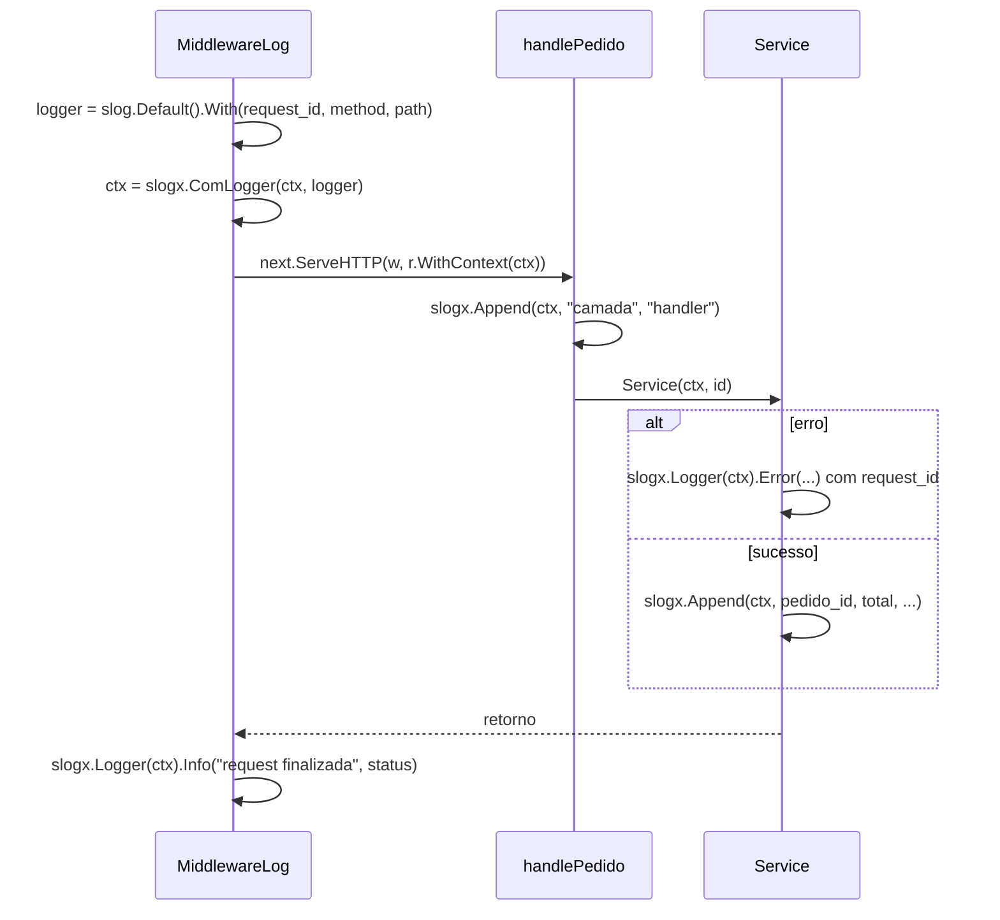

# Logging com slog

Um log em texto livre como `pedido 42 criado para ana` é fácil de ler no terminal e difícil de consultar numa ferramenta de observabilidade. **Logging estruturado** troca a frase por um evento com campos: mensagem, nível e pares chave/valor que podem ser filtrados (`pedido_id = 42`). Desde o Go 1.21, a biblioteca padrão traz o pacote `log/slog` para isso.

## Primeiro log

```go
slog.Info("pedido criado", "pedido_id", "42", "total_centavos", 1990)
```

Sem nenhuma configuração, o `slog` escreve pelo pacote `log` tradicional, e a saída é:

```
2026/10/27 10:00:00 INFO pedido criado pedido_id=42 total_centavos=1990
```

Depois da mensagem vêm pares alternados de chave e valor. Prefira chaves estáveis em `snake_case`, porque elas viram nomes de campo nas ferramentas de busca.

## Logger e Handler

O `slog` separa duas responsabilidades:

- O **Logger** (`*slog.Logger`) é o que o código chama: `Info`, `Warn`, `Error`, `Debug`
- O **Handler** decide **como e onde** o evento é escrito: texto ou JSON, em qual `io.Writer`, a partir de qual nível

```go
jsonLog := slog.New(slog.NewJSONHandler(os.Stdout, &slog.HandlerOptions{
	Level: slog.LevelDebug,
}))
jsonLog.Info("pedido criado", "pedido_id", "42")
// {"time":"...","level":"INFO","msg":"pedido criado","pedido_id":"42"}

textLog := slog.New(slog.NewTextHandler(os.Stdout, nil))
textLog.Info("servidor no ar", "addr", ":8080")
// time=... level=INFO msg="servidor no ar" addr=:8080
```

JSON é o formato usual em produção, porque coletores de log o leem sem configuração extra. Texto é mais confortável no terminal durante o desenvolvimento.

Para trocar o logger usado pelas funções de pacote (`slog.Info`, `slog.Error`), configure o padrão uma vez no `main`:

```go
slog.SetDefault(jsonLog)
```

## Níveis

`Debug` < `Info` < `Warn` < `Error`. O `Level` do handler define o mínimo que aparece: com `slog.LevelInfo`, chamadas `Debug` são descartadas. Um uso comum é ler o nível de uma variável de ambiente, para ligar `Debug` só quando precisar investigar algo.

## `With`: atributos fixos

`With` cria um logger filho que inclui os mesmos atributos em todas as linhas, sem repetir em cada chamada:

```go
reqLog := jsonLog.With("request_id", "req-1", "serviço", "checkout")
reqLog.Info("validando carrinho")
reqLog.Info("cobrando cartão", "meio", "pix")
// as duas linhas trazem request_id e serviço
```

É assim que todas as linhas de uma requisição ganham o mesmo `request_id`, permitindo seguir uma requisição do começo ao fim.

## `Group`: atributos aninhados

```go
jsonLog.Info("cliente",
	slog.Group("user",
		"id", "u-9",
		"plano", "pro",
	),
)
// {"msg":"cliente","user":{"id":"u-9","plano":"pro"}}
```

No handler de texto, o grupo vira prefixo: `user.id=u-9 user.plano=pro`.

## Atributos tipados

A forma chave/valor alternada é prática, mas um valor esquecido desalinha os pares, e o `go vet` só pega parte desses erros. Os construtores tipados evitam isso e alocam menos memória:

```go
slog.Info("pedido criado",
	slog.String("pedido_id", "42"),
	slog.Int("total_centavos", 1990),
	slog.Duration("demora", 120*time.Millisecond),
)
```

Para o caminho mais rápido, `logger.LogAttrs(ctx, slog.LevelInfo, "msg", attrs...)` aceita só atributos tipados.

## Log com dados da requisição

Numa API, você quer que um erro logado lá no service traga o `request_id`, o método e o caminho, que só o middleware conhece. A solução é colocar o logger no [context](/labs/go/concorrencia/04-context/) da requisição:



No exemplo do repositório, o pacote `slogx` implementa esse padrão em poucas funções:

- `ComLogger(ctx, logger)` guarda o logger no context, com uma chave privada
- `Logger(ctx)` recupera o logger, ou `slog.Default()` se não houver
- `Append(ctx, ...)` acumula atributos das camadas, que o middleware inclui no log final da requisição

O resultado é uma linha de fechamento com tudo o que aconteceu:

```json
{
  "msg": "request finalizada",
  "request_id": "req-ok",
  "method": "GET",
  "path": "/pedido",
  "status": 200,
  "camada": "handler",
  "pedido_id": "42",
  "total_centavos": 1990,
  "resultado": "aprovado"
}
```

O próprio `slog` também tem variantes que recebem context (`InfoContext`, `ErrorContext`). Elas repassam o context ao handler, e um handler customizado pode extrair dali o ID de rastreamento do OpenTelemetry, por exemplo.

## Boas práticas

- **Não logue dados sensíveis**: senhas, tokens, números de cartão e dados pessoais. Um tipo pode implementar `slog.LogValuer` para se mascarar automaticamente
- **Logue o erro uma vez só**, na borda (handler ou `main`), como recomenda [Tratamento de Erros](/labs/go/linguagem/03-tratamento-de-erros/)
- **Use o nível certo**: `Error` para o que precisa de atenção, `Warn` para situações anormais que o programa contornou, `Info` para eventos de negócio, `Debug` para investigação
- **Mantenha as chaves consistentes** entre serviços (`request_id` em todos, não `requestId` em um e `req_id` em outro)

## Exemplos no repositório

- [22-slog](https://github.com/caramelotech/go-labs/tree/main/examples/22-slog) - níveis, `With`, `Group`, handlers JSON e texto, e o pacote reutilizável `slogx`
- [23-slog-contexto](https://github.com/caramelotech/go-labs/tree/main/examples/23-slog-contexto) - o `slogx` num middleware HTTP: o erro herda os atributos do middleware e o sucesso acumula `Append` até o log final

```bash
cd examples/23-slog-contexto
go run .
go test ./...
```

No caminho de erro do `camadas.go`, troque `slogx.Logger(ctx)` por `slog.Default()` e veja o `request_id` sumir do log.

## Referências

- [Structured Logging with slog](https://go.dev/blog/slog) - Jonathan Amsterdam, Go Blog, inglês
- [Pacote log/slog](https://pkg.go.dev/log/slog) - documentação oficial, inglês
- [A Guide to Writing slog Handlers](https://github.com/golang/example/blob/master/slog-handler-guide/README.md) - Jonathan Amsterdam, golang/example, inglês
- [OWASP Logging Cheat Sheet](https://cheatsheetseries.owasp.org/cheatsheets/Logging_Cheat_Sheet.html) - OWASP, inglês
