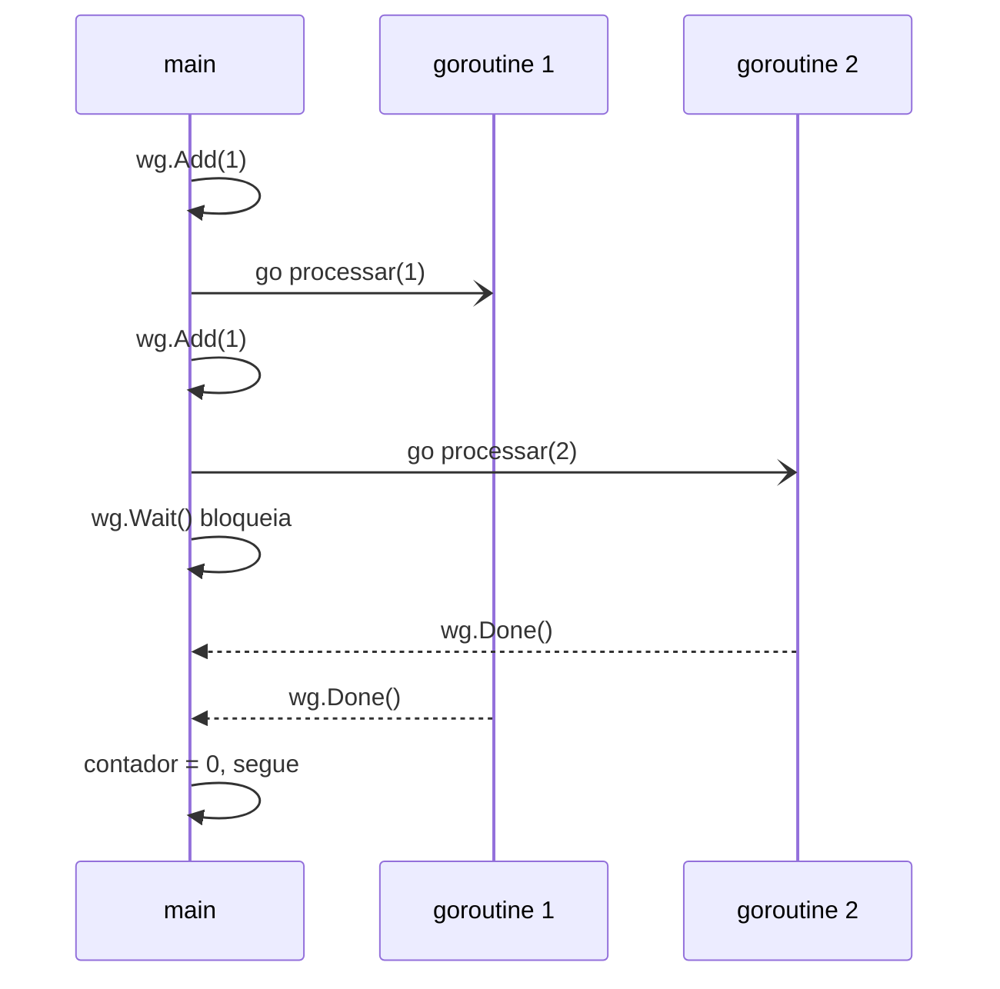

# Goroutines e WaitGroup

Concorrência é um dos motivos pelos quais Go foi criado. Iniciar uma tarefa concorrente custa uma palavra-chave, `go`, e a linguagem traz as ferramentas para coordenar essas tarefas. Esta nota cobre o primeiro passo: lançar trabalho em paralelo e esperar que ele termine.

## Concorrência não é paralelismo

Os dois termos se confundem, mas Rob Pike faz a distinção numa palestra famosa:

- **Concorrência** é a forma de **estruturar** o programa: várias tarefas independentes que progridem ao mesmo tempo, intercaladas
- **Paralelismo** é a **execução** simultânea de verdade, em vários núcleos de CPU

Um programa concorrente roda até num processador de um núcleo só. Com vários núcleos, o runtime do Go distribui as goroutines entre eles e o paralelismo vem de graça. O número de núcleos usados é controlado por `GOMAXPROCS`, que por padrão já considera os núcleos disponíveis.

## Goroutines

Uma goroutine é uma função executando de forma concorrente. Basta colocar `go` antes da chamada:

```go
go processar(1, 100*time.Millisecond)
go func() {
	fmt.Println("rodando em outra goroutine")
}()
```

Goroutines são baratas: começam com uma pilha de poucos KB, que cresce conforme a necessidade, e são agendadas pelo runtime do Go, não pelo sistema operacional. Um programa com dezenas de milhares delas é comum.

## O problema: o `main` não espera

Quando a função `main` retorna, o programa termina, **sem esperar** as goroutines que ainda estão rodando:

```go
func main() {
	go fmt.Println("talvez eu nem apareça")
} // o processo acaba aqui
```

Usar `time.Sleep` para "dar tempo" é um erro: ou espera demais, ou espera de menos. É preciso sincronizar.

## `sync.WaitGroup`

O `WaitGroup` é um contador de tarefas pendentes, com três operações:

1. `wg.Add(n)` soma `n` tarefas, **antes** de lançar a goroutine
2. `wg.Done()` avisa que uma tarefa terminou, normalmente com `defer`
3. `wg.Wait()` bloqueia até o contador chegar a zero

```go
var wg sync.WaitGroup

for i, demora := range tarefas {
	wg.Add(1)
	go func(id int, d time.Duration) {
		defer wg.Done()
		processar(id, d)
	}(i+1, demora)
}

wg.Wait()
fmt.Println("todas as tarefas concluídas")
```



Três regras para não errar:

- Chame `Add` **antes** do `go`, não dentro da goroutine. Se a goroutine demorar para começar, o `Wait` pode encontrar o contador em zero e seguir cedo demais
- Use `defer wg.Done()` na primeira linha da goroutine, para o `Done` acontecer mesmo se a função retornar cedo
- Passe o `WaitGroup` por ponteiro se ele for para outra função. Copiar um `WaitGroup` cria um contador separado, e o `go vet` avisa

### `wg.Go` (Go 1.25+)

O padrão `Add` + `go` + `defer Done` é tão comum que o Go 1.25 ganhou um atalho:

```go
var wg sync.WaitGroup
for i := range 4 {
	wg.Go(func() {
		processar(i+1, 100*time.Millisecond)
	})
}
wg.Wait()
```

O exemplo do repositório usa a forma explícita, que funciona em qualquer versão e deixa visível o que está acontecendo.

## Variáveis do laço e closures

O exemplo passa `i` e `demora` como **parâmetros** da função anônima. Antes do Go 1.22, a variável do `for` era uma só para todas as iterações, e uma goroutine que a lesse direto podia ver o valor da última iteração. Desde o 1.22 cada iteração tem sua própria variável, e o bug sumiu para módulos com `go 1.22` ou superior. Passar por parâmetro continua válido e deixa explícito o que cada goroutine recebe.

## Corrida de dados e o `-race`

Quando duas goroutines acessam a mesma variável, e pelo menos uma escreve, sem sincronização, acontece uma **corrida de dados** (data race). O resultado é imprevisível, e o bug pode aparecer uma vez a cada mil execuções.

O Go traz um detector embutido:

```bash
go run -race .
go test -race ./...
```

Ele avisa a linha exata dos dois acessos conflitantes. Rode todo teste de código concorrente com `-race`. As formas de evitar corridas são os [channels](/labs/go/concorrencia/02-channels-e-select/) e os [mutexes](/labs/go/concorrencia/05-mutex-e-estado-compartilhado/).

## Goroutine que nunca termina

Toda goroutine que você lança precisa ter um jeito de terminar. Uma goroutine bloqueada para sempre esperando um channel que ninguém vai escrever é um **vazamento** (goroutine leak): ela segura memória até o processo acabar. O cancelamento com [context](/labs/go/concorrencia/04-context/) existe para isso.

## Exemplo no repositório

O exemplo [17-goroutines-waitgroup](https://github.com/caramelotech/go-labs/tree/main/examples/17-goroutines-waitgroup) lança quatro tarefas com durações diferentes e mede o tempo total, que fica perto da tarefa mais lenta (150ms), e não da soma (400ms). Comente o `wg.Wait()` e rode de novo para ver o programa terminar antes do trabalho.

```bash
cd examples/17-goroutines-waitgroup
go run -race .
```

## Referências

- [Concurrency is not parallelism](https://go.dev/blog/waza-talk) - Rob Pike, Go Blog, inglês
- [Effective Go - Concurrency](https://go.dev/doc/effective_go#concurrency) - Go Team, inglês
- [A Tour of Go - Goroutines](https://go.dev/tour/concurrency/1) - Go Team, inglês
- [Data Race Detector](https://go.dev/doc/articles/race_detector) - Go Team, inglês
- [Pacote sync - WaitGroup](https://pkg.go.dev/sync#WaitGroup) - documentação oficial, inglês
