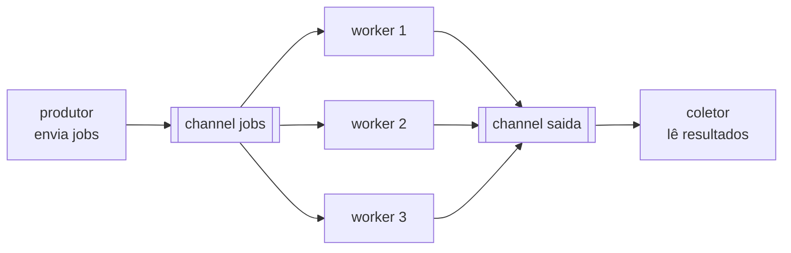

# Worker Pool e Padrões de Concorrência

Lançar uma goroutine por item funciona com dez itens. Com dez mil URLs para verificar, você abre dez mil conexões ao mesmo tempo, estoura limites do servidor e da sua máquina. O **worker pool** resolve isso: um número fixo de goroutines (os workers) consome tarefas de uma fila e devolve os resultados por outra.

## A estrutura



As peças:

1. Um channel `jobs` com as tarefas
2. N workers, cada um lendo de `jobs` com `for range` até o channel fechar
3. Um channel `saida` com os resultados
4. Um `WaitGroup` para saber quando todos os workers terminaram, e só então fechar `saida`
5. Um `context` com timeout para ninguém ficar preso numa tarefa lenta

## O worker

```go
func worker(ctx context.Context, id int, jobs <-chan job, saida chan<- resultado) {
	for j := range jobs {
		fmt.Printf("worker %d: verificando %s\n", id, j.URL)
		saida <- verificar(ctx, j)
	}
}
```

Repare nas direções dos channels: o worker só **lê** de `jobs` e só **escreve** em `saida`. O `for range` encerra o worker quando o produtor fechar `jobs`.

## Montando o pool

```go
jobs := make(chan job)
saida := make(chan resultado)

// 1. sobe N workers
var wg sync.WaitGroup
for w := 1; w <= numWorkers; w++ {
	wg.Add(1)
	go func(id int) {
		defer wg.Done()
		worker(ctx, id, jobs, saida)
	}(w)
}

// 2. produtor: envia os jobs e fecha
go func() {
	defer close(jobs)
	for _, j := range jobsLista {
		select {
		case <-ctx.Done():
			return
		case jobs <- j:
		}
	}
}()

// 3. fecha saida só depois que todos os workers terminarem
go func() {
	wg.Wait()
	close(saida)
}()

// 4. coleta no main
for r := range saida {
	// conta e imprime
}
```

O passo 3 é o ponto mais delicado. Se o `main` fechasse `saida` direto, um worker ainda ativo tentaria enviar num channel fechado e causaria panic. Esperar o `WaitGroup` numa goroutine separada garante que `saida` só fecha quando ninguém mais escreve nela, e aí o `range` do passo 4 termina sozinho.

O produtor usa `select` no envio para parar de enfileirar trabalho quando o context é cancelado, em vez de ficar bloqueado esperando um worker que não vai mais ler.

## Cancelando com context

Cada verificação compete com o prazo do context:

```go
func verificar(ctx context.Context, j job) resultado {
	timer := time.NewTimer(j.Demora)
	defer timer.Stop()

	select {
	case <-ctx.Done():
		return resultado{URL: j.URL, Err: ctx.Err()}
	case <-timer.C:
		return resultado{URL: j.URL, OK: j.OK, Demora: j.Demora}
	}
}
```

Quando o timeout de 400ms estoura, `ctx.Done()` fecha e todos os workers que estão esperando saem com `context deadline exceeded`. O `defer timer.Stop()` libera o timer quando o context vence primeiro. Os detalhes do `context` estão na próxima nota, [Context](/labs/go/concorrencia/04-context/).

## Outras formas de limitar concorrência

### Semáforo com channel com buffer

Quando a tarefa já está num laço e você só quer um teto de goroutines simultâneas, um channel com buffer funciona como semáforo:

```go
sem := make(chan struct{}, 3) // no máximo 3 ao mesmo tempo

for _, url := range urls {
	wg.Add(1)
	go func(u string) {
		defer wg.Done()
		sem <- struct{}{}        // ocupa uma vaga (bloqueia se não houver)
		defer func() { <-sem }() // libera a vaga
		checar(u)
	}(url)
}
wg.Wait()
```

### `errgroup`

O pacote [`golang.org/x/sync/errgroup`](https://pkg.go.dev/golang.org/x/sync/errgroup), mantido pelo time do Go fora da biblioteca padrão, junta `WaitGroup`, limite de concorrência (`SetLimit`), coleta do primeiro erro e cancelamento de context. Em código de produção, ele substitui boa parte do código manual acima. Vale aprender a versão manual primeiro, para entender o que o `errgroup` faz por você.

## Pipelines, fan-out e fan-in

O worker pool é um caso de padrões mais gerais descritos no blog oficial do Go:

- **Pipeline**: uma sequência de estágios ligados por channels, em que cada estágio recebe valores, processa e envia para o próximo
- **Fan-out**: vários workers lendo do mesmo channel, dividindo o trabalho (os N workers acima)
- **Fan-in**: juntar vários channels de resultado num só (o channel `saida`, escrito por todos os workers)

## Exemplo no repositório

O exemplo [19-worker-pool](https://github.com/caramelotech/go-labs/tree/main/examples/19-worker-pool) verifica cinco "URLs" simuladas com timers, três workers e timeout de 400ms. A URL lenta (800ms) é cancelada e as outras completam.

```bash
cd examples/19-worker-pool
go run -race .
```

Mude `numWorkers` para `1` e compare o tempo, ou suba `timeout` para `1s` e veja o cancelamento sumir. Este exemplo é a base do Projeto 04, o Verificador de Links Concorrente, em [Projetos](/labs/go/pratica/02-projetos/).

## Referências

- [Go Concurrency Patterns: Pipelines and cancellation](https://go.dev/blog/pipelines) - Sameer Ajmani, Go Blog, inglês
- [Go by Example - Worker Pools](https://gobyexample.com/worker-pools) - Mark McGranaghan e Eli Bendersky, inglês
- [Go Concurrency Patterns: Context](https://go.dev/blog/context) - Sameer Ajmani, Go Blog, inglês
- [Pacote errgroup](https://pkg.go.dev/golang.org/x/sync/errgroup) - documentação oficial, inglês
