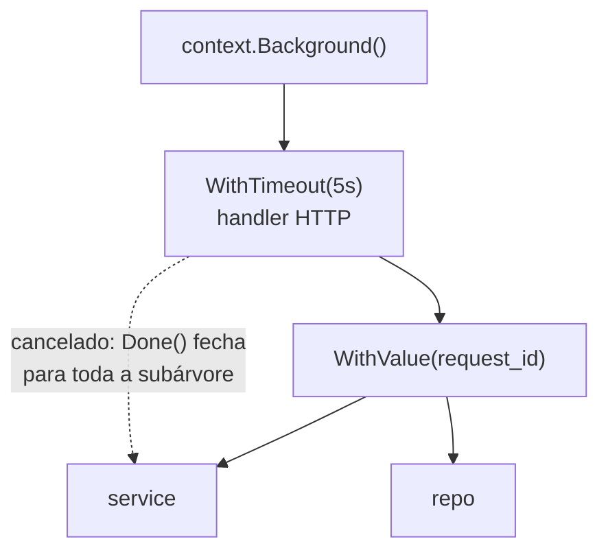

# Context

Um servidor recebe uma requisição, consulta o banco, chama outro serviço e monta a resposta. No meio do caminho, o cliente fecha o navegador. Sem nenhum aviso, o servidor continua trabalhando para ninguém. O pacote `context` é a forma padrão de propagar esse aviso, junto com prazos e alguns dados da requisição, por todas as camadas do programa.

## O que um `context.Context` carrega

1. **Sinal de cancelamento**: o canal `ctx.Done()` fecha quando o trabalho deve parar
2. **Prazo**: um horário limite, depois do qual o context é cancelado sozinho
3. **Valores**: dados do escopo da requisição, como um ID de rastreamento

Contexts formam uma árvore. Cada função cria um context **filho** a partir do que recebeu, e cancelar um pai cancela todos os filhos.



## Criando contexts

| Função                             | Para quê                                                |
| ---------------------------------- | ------------------------------------------------------- |
| `context.Background()`             | Raiz da árvore, no `main`, em testes e na inicialização |
| `context.TODO()`                   | Raiz provisória, quando ainda não se sabe qual usar     |
| `context.WithCancel(pai)`          | Filho cancelado manualmente com `cancel()`              |
| `context.WithTimeout(pai, d)`      | Filho cancelado depois da duração `d`                   |
| `context.WithDeadline(pai, t)`     | Filho cancelado no horário `t`                          |
| `context.WithValue(pai, chave, v)` | Filho que carrega um valor                              |

As três primeiras devolvem uma função `cancel`. **Sempre** chame essa função, normalmente com `defer`, mesmo que o prazo vença sozinho: ela libera os recursos internos do context. O `go vet` avisa quando um `cancel` é descartado.

```go
ctx, cancel := context.WithTimeout(context.Background(), 50*time.Millisecond)
defer cancel()
```

## Respeitando o cancelamento

Receber um context não cancela nada por mágica. A função precisa **consultar** o context enquanto trabalha. Em operações de espera, isso é um `select` com `ctx.Done()`:

```go
func Trabalhar(ctx context.Context, nome string, demora time.Duration) error {
	timer := time.NewTimer(demora)
	defer timer.Stop()

	select {
	case <-ctx.Done():
		return fmt.Errorf("%s: %w", nome, ctx.Err())
	case <-timer.C:
		return nil
	}
}
```

Em laços de processamento, confira `ctx.Err()` a cada iteração. A biblioteca padrão já faz isso por você em `net/http`, `database/sql` e outros pacotes que recebem context.

`ctx.Err()` diz o motivo do cancelamento, e os dois valores são sentinelas que você compara com `errors.Is`:

- `context.Canceled`: alguém chamou `cancel()`
- `context.DeadlineExceeded`: o prazo venceu

## Propagando pelas camadas

As regras de uso estão na documentação do pacote:

- O context é o **primeiro parâmetro** e se chama `ctx`: `func Buscar(ctx context.Context, id string)`
- **Não guarde** context dentro de structs; passe explicitamente a cada chamada
- Nunca passe `nil`; na dúvida, use `context.TODO()`

```go
func Handler(ctx context.Context, acao string) error {
	return Service(ctx, acao)
}

func Service(ctx context.Context, acao string) error {
	return Repo(ctx, acao)
}
```

Quem **cria** o context (o servidor HTTP, o `main`, o teste) define timeout e cancelamento. Quem **recebe** só repassa e respeita.

## Context no HTTP

No servidor, `r.Context()` já vem pronto e é cancelado quando o cliente desconecta. No cliente, `http.NewRequestWithContext` amarra a requisição a um context:

```go
req, err := http.NewRequestWithContext(ctx, http.MethodGet, url, nil)
if err != nil {
	return err
}
resp, err := http.DefaultClient.Do(req) // aborta se ctx for cancelado
```

## Valores no context

`WithValue` serve para dados **transversais da requisição**, que atravessam camadas sem fazer parte da lógica de cada uma: ID da requisição, usuário autenticado, logger, transação aberta.

A chave deve ser de um **tipo privado do pacote**, nunca uma string pura, para evitar colisão com chaves de outros pacotes:

```go
type chaveRequestID struct{}

func ComRequestID(ctx context.Context, id string) context.Context {
	return context.WithValue(ctx, chaveRequestID{}, id)
}

func RequestID(ctx context.Context) (string, bool) {
	id, ok := ctx.Value(chaveRequestID{}).(string)
	return id, ok
}
```

Expor funções como `ComRequestID` e `RequestID`, em vez da chave, mantém o tipo seguro para quem usa.

**Não** use context para passar dependências obrigatórias, como conexão com banco, configuração ou serviços. Elas vão em parâmetros ou em campos da struct do serviço. Dependência escondida no context compila, mas falha só em tempo de execução, quando alguém esquece de colocá-la lá.

## Exemplo no repositório

O exemplo [20-context](https://github.com/caramelotech/go-labs/tree/main/examples/20-context) cobre cinco casos, um por arquivo:

1. `caso_timeout.go` - `WithTimeout` encerra uma consulta lenta
2. `caso_cancel_conexao.go` - `cancel()` simula o cliente fechando a conexão e as três camadas param
3. `caso_http_cancel.go` - o mesmo com HTTP real: `httptest`, `r.Context()` e `NewRequestWithContext`
4. `caso_valores.go` - `request_id` desce do handler ao repo via `WithValue`
5. `caso_transacao.go` - o service abre uma transação e os repos a recuperam com `TxFrom(ctx)`

```bash
cd examples/20-context
go run .
go test -v
```

Os testes conferem `context.DeadlineExceeded` e `context.Canceled` com `errors.Is`.

## Referências

- [Go Concurrency Patterns: Context](https://go.dev/blog/context) - Sameer Ajmani, Go Blog, inglês
- [Contexts and structs](https://go.dev/blog/context-and-structs) - Jean Barkhuysen e Matt T. Proud, Go Blog, inglês
- [Pacote context](https://pkg.go.dev/context) - documentação oficial, inglês
- [Go Code Review Comments - Contexts](https://go.dev/wiki/CodeReviewComments#contexts) - Go Wiki, inglês
