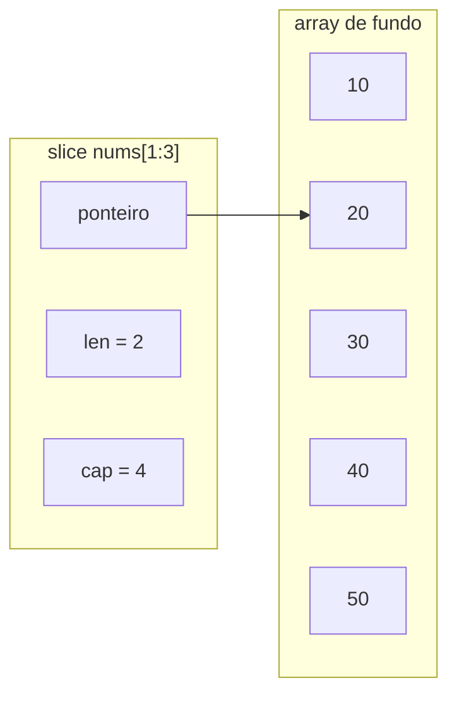

# Arrays e Slices

Para guardar uma sequência de valores do mesmo tipo, Go tem dois tipos: o **array**, de tamanho fixo, e o **slice**, de tamanho dinâmico. No dia a dia quase tudo é slice, mas entender o array é o que explica como o slice funciona.

## Arrays

O tamanho de um array faz parte do tipo. `[3]string` e `[4]string` são tipos diferentes e não podem ser atribuídos um ao outro:

```go
var letras [3]string = [3]string{"a", "b", "c"}
numeros := [...]int{10, 20, 30} // o compilador conta: [3]int
```

Arrays são **valores**: atribuir um array a outra variável, ou passá-lo para uma função, copia todos os elementos. Por isso eles aparecem pouco em código de aplicação. Os usos mais comuns são buffers de tamanho conhecido e chaves de map compostas (`map[[2]int]bool`).

## Slices

Um slice é uma **janela** sobre um array. Por baixo dos panos, ele é uma pequena estrutura com três campos:



- **ponteiro** para o primeiro elemento visível
- **`len`**: quantos elementos o slice enxerga
- **`cap`**: quantos elementos cabem do início do slice até o fim do array de fundo

### Criando slices

```go
nums := []int{10, 20, 30}     // literal: len 3, cap 3
zeros := make([]int, 3)       // [0 0 0]
buffer := make([]int, 0, 100) // len 0, cap 100: espaço reservado
var vazio []int               // nil: len 0, cap 0
```

Um slice `nil` funciona com `len`, `range` e `append`, então raramente você precisa diferenciá-lo de um slice vazio. A diferença aparece ao serializar JSON: `nil` vira `null` e `[]int{}` vira `[]`.

### `append`

`append` adiciona elementos no fim e **devolve um novo slice**, que precisa ser atribuído de volta:

```go
nums = append(nums, 40, 50)
nums = append(nums, outros...) // junta outro slice
```

Quando a capacidade acaba, `append` aloca um array maior, copia os elementos e devolve um slice apontando para o array novo. Se você já sabe quantos elementos vai ter, reserve a capacidade com `make([]T, 0, n)` e evite essas realocações.

### Fatiamento

`s[i:j]` cria um slice do índice `i` até `j-1` (o fim não é incluído). Os limites podem ser omitidos: `s[:2]`, `s[2:]`, `s[:]`.

```go
meio := nums[1:4] // [20 30 40]
```

## A armadilha do array compartilhado

Fatiar **não copia** os dados. O slice novo aponta para o mesmo array de fundo, então alterar um afeta o outro:

```go
original := []int{10, 20, 30, 40}
parte := original[1:3] // [20 30]
parte[0] = 999
fmt.Println(original) // [10 999 30 40]
```

O mesmo vale para `append` em um slice que ainda tem capacidade sobrando: ele escreve no array compartilhado e pode sobrescrever elementos do slice original. Quando precisar de independência, copie:

```go
copia := make([]int, len(original))
copy(copia, original)
```

Desde o Go 1.21, `slices.Clone(original)` faz a mesma coisa em uma linha.

## O pacote `slices`

O pacote `slices` da biblioteca padrão (Go 1.21+) cobre as operações que antes exigiam laços manuais:

```go
nomes := []string{"Caramelo", "Ana", "Bruno"}

slices.Sort(nomes)                    // [Ana Bruno Caramelo]
slices.Contains(nomes, "Ana")         // true
i := slices.Index(nomes, "Bruno")     // 1
iguais := slices.Equal(nomes, outros) // compara elemento a elemento
maior := slices.Max([]int{3, 9, 4})   // 9
```

Slices não podem ser comparados com `==` (exceto com `nil`), então `slices.Equal` é o caminho.

## Exemplo no repositório

O exemplo [06-slices](https://github.com/caramelotech/go-labs/tree/main/examples/06-slices) mostra literal, `make`, `append` com `len` e `cap`, fatiamento, um array convertido em slice com `arr[:]` e `copy` para evitar o compartilhamento. Experimente imprimir `len` e `cap` a cada `append` dentro de um laço para ver a capacidade crescer.

## Referências

- [Go Slices: usage and internals](https://go.dev/blog/slices-intro) - Andrew Gerrand, Go Blog, inglês
- [Arrays, slices (and strings): The mechanics of 'append'](https://go.dev/blog/slices) - Rob Pike, Go Blog, inglês
- [A Tour of Go - Slices](https://go.dev/tour/moretypes/7) - Go Team, inglês
- [Pacote slices](https://pkg.go.dev/slices) - documentação oficial, inglês
