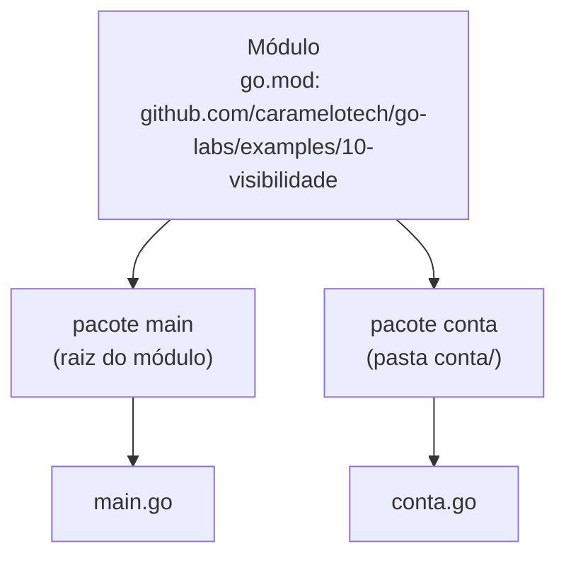

# Pacotes e Visibilidade

Todo código Go vive dentro de um **pacote**, e todo pacote vive dentro de um **módulo**. Entender essa organização e a regra de visibilidade é o que permite dividir um programa em partes que não se atropelam.

## Módulo, pacote e arquivo



- **Módulo**: o projeto, definido pelo `go.mod`. O caminho declarado ali (`module github.com/...`) é o prefixo de todos os imports internos. A criação de módulos está em [Configurando o Ambiente](/labs/go/fundamentos/01-ambiente/).
- **Pacote**: uma **pasta**. Todos os arquivos `.go` de uma pasta declaram o mesmo `package` e enxergam tudo uns dos outros, como se fossem um arquivo só.
- **Import path**: caminho do módulo + caminho da pasta. Para usar o pacote `conta` acima: `import "github.com/caramelotech/go-labs/examples/10-visibilidade/conta"`.

O pacote `main` é especial: ele gera um executável e precisa ter uma `func main()`.

## Exportado ou não: a primeira letra decide

Go não tem `public`, `private` ou `protected`. A regra é uma só, e vale para tipos, funções, métodos, campos, constantes e variáveis:

- Nome que começa com **letra maiúscula** é **exportado**: visível em outros pacotes
- Nome que começa com **letra minúscula** é **não exportado**: visível só dentro do próprio pacote

```go
package conta

type Conta struct {
	Titular string // exportado
	saldo   int    // só o pacote conta acessa
}

// New é exportada: outros pacotes chamam conta.New(...)
func New(titular string, saldoInicial int) Conta {
	return Conta{Titular: titular, saldo: saldoInicial}
}

// Saldo expõe a leitura sem permitir escrita direta no campo.
func (c Conta) Saldo() int {
	return c.saldo
}
```

Em outro pacote, `c.Titular` funciona, e `c.saldo` dá erro de compilação. Esse é o mecanismo de encapsulamento da linguagem: o pacote `conta` garante que ninguém de fora coloque um saldo negativo direto no campo.

### `internal/`

Um pacote dentro de uma pasta chamada `internal` só pode ser importado por código que está na pasta pai dela. `meuapp/internal/banco` pode ser usado por `meuapp/cmd/api`, mas não por outro módulo. É a forma de compartilhar código entre pacotes do seu projeto sem transformá-lo em API pública.

## Nomeando pacotes

Quem importa o pacote escreve o nome dele toda vez (`strings.ToUpper`, `http.Get`). Por isso o [Effective Go](https://go.dev/doc/effective_go#package-names) pede nomes bons:

- **Curtos, minúsculos e de uma palavra**: `saudacao`, `http`, `json`. Nada de `saudacao_utils` ou `SaudacaoLib`
- **Iguais ao nome da pasta**: a pasta `saudacao/` declara `package saudacao`
- **Sem nomes genéricos** como `util`, `common` ou `helpers`, que não dizem nada sobre o conteúdo

### Não repita o nome do pacote

O nome do pacote já é um prefixo, então os identificadores não precisam repeti-lo:

| Evite              | Prefira    | Quem importa lê     |
| ------------------ | ---------- | ------------------- |
| `SaudacaoMensagem` | `Mensagem` | `saudacao.Mensagem` |
| `NewMensagem`      | `New`      | `saudacao.New`      |
| `GetTexto()`       | `Texto()`  | `m.Texto()`         |

A biblioteca padrão segue a mesma regra: `bufio.Reader` (não `bufio.BufReader`) e `ring.New` (não `ring.NewRing`). Getters também não levam `Get`: um campo `texto` é lido pelo método `Texto()`, e o setter, se existir, se chama `SetTexto`.

## Imports

```go
import (
	"fmt"
	"os"

	crand "crypto/rand" // alias para evitar conflito
	"math/rand"

	"github.com/caramelotech/go-labs/examples/12-nomes-de-pacotes/saudacao"
)
```

- Por convenção, a biblioteca padrão fica em um grupo e os pacotes externos em outro
- Import não usado é erro de compilação; o `gopls` e o `goimports` cuidam disso ao salvar
- Use alias só quando dois pacotes têm o mesmo nome
- Evite `import . "pacote"`, que esconde de onde vem cada nome

Para usar um pacote de terceiros, rode `go get` com o caminho dele, e o `go.mod` registra a dependência. Para apontar um import para uma pasta local, existe a diretiva `replace` no `go.mod`; o exemplo [23-slog-contexto](https://github.com/caramelotech/go-labs/tree/main/examples/23-slog-contexto) usa isso para importar o pacote `slogx` do exemplo 22.

## Exemplos no repositório

- [10-visibilidade](https://github.com/caramelotech/go-labs/tree/main/examples/10-visibilidade) - o pacote `conta` com campo exportado (`Titular`) e não exportado (`saldo`), getter `Saldo()` e uma função privada `extrato` usada por `Resumo`. Descomente `fmt.Println(c.saldo)` no `main.go` e leia o erro do compilador.
- [12-nomes-de-pacotes](https://github.com/caramelotech/go-labs/tree/main/examples/12-nomes-de-pacotes) - o pacote `saudacao` com `New`, `Mensagem`, `Texto()` e `Ola`, aplicando as regras de nomes do Effective Go.

## Referências

- [Effective Go - Package names](https://go.dev/doc/effective_go#package-names) - Go Team, inglês
- [Package names](https://go.dev/blog/package-names) - Sameer Ajmani, Go Blog, inglês
- [Organizing a Go module](https://go.dev/doc/modules/layout) - Go Team, inglês
- [How to Write Go Code](https://go.dev/doc/code) - Go Team, inglês
