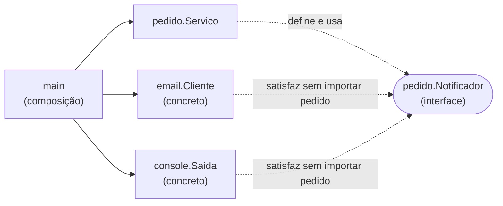

# Interfaces

Uma interface descreve **o que um tipo sabe fazer**, sem dizer como. Ela é uma lista de assinaturas de métodos, e qualquer tipo que tenha esses métodos satisfaz a interface automaticamente.

## Satisfação implícita

```go
type Notificador interface {
	Notificar(destino, mensagem string) error
}
```

Qualquer tipo com um método `Notificar(string, string) error` **é** um `Notificador`. Não existe `implements`: o tipo não precisa saber que a interface existe.

```go
type Cliente struct {
	de string
}

func (c Cliente) Notificar(destino, mensagem string) error {
	fmt.Printf("[email %s -> %s] %s\n", c.de, destino, mensagem)
	return nil
}

var n Notificador = Cliente{de: "noreply@caramelo.dev"} // compila
```

Essa característica muda a forma de desenhar código. Em Java ou C#, quem escreve a classe decide quais interfaces ela implementa. Em Go, quem **usa** o tipo pode criar uma interface depois, sem mexer no tipo, e até para tipos de bibliotecas de terceiros.

## Interfaces pequenas

As interfaces mais usadas da biblioteca padrão têm um método só:

```go
type Reader interface {
	Read(p []byte) (n int, err error)
}

type Writer interface {
	Write(p []byte) (n int, err error)
}

type Stringer interface {
	String() string
}

type error interface {
	Error() string
}
```

Por causa disso, a mesma função funciona com arquivo, conexão de rede, buffer em memória e resposta HTTP: todos são `io.Writer`. O provérbio de Rob Pike resume: _"The bigger the interface, the weaker the abstraction"_ (quanto maior a interface, mais fraca a abstração).

Interfaces maiores são montadas juntando as pequenas:

```go
type ReadWriter interface {
	Reader
	Writer
}
```

## A interface fica no consumidor

A recomendação do [Go Code Review Comments](https://go.dev/wiki/CodeReviewComments#interfaces) é declarar a interface no pacote que **usa** o comportamento, não no pacote que o implementa. O pacote provedor exporta um tipo concreto, e o consumidor define só os métodos de que precisa.



No exemplo [13-interface-consumidor](https://github.com/caramelotech/go-labs/tree/main/examples/13-interface-consumidor):

- `pedido` declara `Notificador` e recebe a implementação em `pedido.New(n Notificador)`
- `email` e `console` exportam tipos concretos e **não importam** `pedido`
- o `main` é o único lugar que conhece os dois lados e faz a **injeção de dependência**

```go
mail := email.New("noreply@caramelo.dev")
svc, err := pedido.New(mail)
```

Trocar o e-mail por SMS, webhook ou console muda só o `main`. E o teste de `pedido` usa um fake declarado no próprio arquivo de teste, sem enviar nada de verdade (veja [Testes](/labs/go/linguagem/04-testes/)).

Daí vem um ditado comum na comunidade: **aceite interfaces, devolva structs**. Funções recebem o comportamento mínimo de que precisam e devolvem tipos concretos, que o chamador pode usar por inteiro.

## Verificação em tempo de compilação

Como a satisfação é implícita, às vezes vale garantir que um tipo continua satisfazendo uma interface. A linha abaixo não gera código, só falha a compilação se `Cliente` deixar de ter `Notificar`:

```go
var _ pedido.Notificador = email.Cliente{}
```

## `any`, type assertion e type switch

A interface vazia `interface{}`, com o apelido `any` desde o Go 1.18, não exige nenhum método. Todo tipo a satisfaz, então ela aceita qualquer valor. O preço é perder a verificação de tipos: para usar o valor, você precisa descobrir o que tem dentro.

**Type assertion** extrai o tipo concreto. Use sempre a forma com `ok`, que não causa panic:

```go
var v any = "caramelo"

s, ok := v.(string)
if ok {
	fmt.Println(strings.ToUpper(s))
}
```

**Type switch** decide entre vários tipos possíveis:

```go
func descrever(v any) string {
	switch x := v.(type) {
	case int:
		return fmt.Sprintf("inteiro %d", x)
	case string:
		return fmt.Sprintf("texto %q", x)
	case fmt.Stringer:
		return x.String()
	default:
		return fmt.Sprintf("tipo %T", x)
	}
}
```

Use `any` com moderação. Se uma função recebe `any` e logo faz um type switch, muitas vezes uma interface com método, ou generics, expressaria melhor a intenção.

## A armadilha da interface "quase nil"

Um valor de interface guarda dois dados: o **tipo** concreto e o **valor**. Ele só é `nil` quando os dois são vazios. Um ponteiro `nil` guardado numa interface deixa a interface **diferente de `nil`**:

```go
func buscar() error {
	var err *ErrValidacao // ponteiro nil
	return err            // a interface error agora tem tipo *ErrValidacao
}

fmt.Println(buscar() == nil) // false
```

Quando não houver erro, devolva `nil` literal, nunca uma variável de ponteiro tipado que esteja `nil`.

## Exemplo no repositório

O exemplo [13-interface-consumidor](https://github.com/caramelotech/go-labs/tree/main/examples/13-interface-consumidor) monta tudo o que esta nota descreve: interface no consumidor, dois provedores concretos, injeção no `main`, validação de dependência obrigatória em `New` e testes com fake. Rode `go run .` e depois `go test ./...`.

## Referências

- [Effective Go - Interfaces and other types](https://go.dev/doc/effective_go#interfaces_and_types) - Go Team, inglês
- [Go Code Review Comments - Interfaces](https://go.dev/wiki/CodeReviewComments#interfaces) - Go Wiki, inglês
- [Go Proverbs](https://go-proverbs.github.io/) - Rob Pike, inglês
- [Go FAQ - Why is my nil error value not equal to nil?](https://go.dev/doc/faq#nil_error) - Go Team, inglês
- [A Tour of Go - Interfaces](https://go.dev/tour/methods/9) - Go Team, inglês
